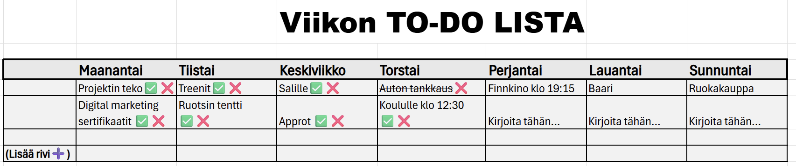
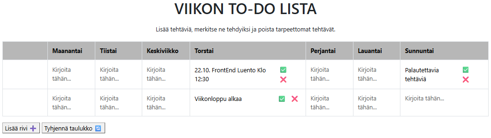

# Projektin nimi

**Tekijä(t):** Emil Salmenkylä & Eetu Pyykkö

## Projektisuunnitelma

### Projektin idea

Projektimme idea on tehdä To do lista.
Listan tarkoitus on, että kuka tahansa henkilö voi päivittää sinne
tietyn viikonpäivän kohdalle suunnitellut menot, kuten tapahtumat, palautuksien Deadlinet tai mitä tahansa mieleen tulee tietyn päivän kohdalle, taivas vain rajana.

### Suunnitellut toiminnot

- Nappia painamalla rivin lisäys viikonpäivän alle, johon voi syöttää tietoja
- Nappia painamalla rivin poisto
- Check mark ✅ "Ruksaus toiminto", jossa voi merkata tehdyt asiat valmiiksi

### Rautalankamalli / luonnos

## Verkkolinkit

- **Julkaistu sovellus:** [Lisää tähän GitHub Pages -osoite](https://yourusername.github.io/your-repository/)
- **GitHub-repositorio:** [Repositorion linkki](https://github.com/EmilSalmenkyla/Projekti_1_DOM_Skriptaus)
- **Projektin videoesittely:** [Lisää tähän videon osoite](https://example.com/)

## Tietoja sovelluksesta

**[VIIKON TO-DO LISTA]** on verkkosovellus, jonka tarkoitus on
helpottaa ihmisten viikolla tapahtuvien suunnitelmien hahmottamista.
Jokaisen viikonpäivän kohdalle voi "Kirjoita tähän..." kohtaa painamalla lisätä tehtävän. Tämän pystyy vielä peruuttamaan painamalla "Peruuta" painiketta tai lisäämään painamalla "Lisää" painiketta. Vähimmäis vaatimuus kirjoitetulle tekstille on 3 merkkiä, mutta maksimia ei asetettu (Ei tiedetty minkälaisia tekstejä käyttäjät lisäilisi, niin ei päätetty rajoittaa) niin taulukko skaalautuu tekstin mukaan.
TO-DO listaan voi laittaa ihan mitä tahansa: suunniteltu tapahtuma, tekeminen tai ihan mitävään. Sen voi merkata valmiiksi tai poistaa kokonaan viereisillä painikkeilla. 

## Teknologiat

- HTML – sivun rakenne
  - Perus toiminallisuus (Taulukko pohjana, johon lisätty toiminnallisuutta)

- CSS – ulkoasu ja asettelu
  - Pienet tyylilliset muokkaukset selkeyttämään käyttöliittymää

- JavaScript – toiminnallisuus, DOM-skriptaus ja lomakkeiden validointi
  - Pääpainoarvo projektissa, jotta kaikki toiminnallisuus taulukossa toimii

- localStorage – tietojen tallentaminen selaimeen, jos käytit sitä
  - Tietojen tallennus, jotta lisätyt TO-DO listan tehtävät säilyvät sivun päivityksen jälkeen

## Sovelluksen käyttö

1. Avaa julkaistu sovellus yllä olevasta linkistä.
2. Täytä lomakkeen kentät haluttujen viikonpäivien alle "Kirjoita tähän..." kohtaan.
3. Lisää, peruuta lisäys, poista tai merkitse kohteita tehdyiksi. 
  - Taulukon resetointi erillisellä painikkeella.
4. Sivun voi päivittää, tietojen ei pitäisi kadota ennen, kuin painaa "Tyhjennä taulukko" painiketta.

## Sovelluksen käynnistäminen paikallisesti

1. Kloonaa tai lataa tämä repositorio omalle koneellesi.
2. Avaa projektikansio.
3. Avaa `index.html` selaimessa.

## Kuvakaappaukset

Lisää tähän vähintään yksi kuvakaappaus toimivasta sovelluksestasi.

Esimerkki kuvan lisäämisestä:

## Tunnetut virheet / puutteet

**Ei tunnettuja virheitä.**

 - Puutteita ehkä tyylissä, käyttöliittymä ei ole "hiottu" aivan loppuun, mutta se ainakin toimii.

## Työn jakautuminen

- Tekijä 1: Eetu Pyykkö
- Tekijä 2: Emil Salmenkylä

Työ jakautui aika tasaisesti, juttelimme discordissa eri kohdista ja ilmoitimme lähes aina, kuin teimme muutoksia. Aluksi ajattelimme, että haasteeksi tulee Github repositorion commitit, mutta todellisuudessa parikoodaus jakautui niin, ettei molemmat ollut tekemässä samaan aikaan, niin projektin teko selkeytyi. Mitään selkeää työnjakoa ei ollut vaikka toinen työsti vuorollaan seuraavaa sovelluksen osa-aluetta, toinen ns. "paranteli" jälkeenpäi ja jatkoi kehittelyä.

## Oma arvio ja oppimisen reflektointi

Pohdi työtäsi ja oppimisprosessiasi.

- Missä onnistuin?
  - Saatiin toimiva TO-DO lista rakennettua taulukkoon

- Mikä oli haastavaa?
- Mitä parantaisin, jos aikaa olisi enemmän?
- Mitä opin HTML:stä, CSS:stä, JavaScriptistä ja DOM-skriptauksesta?
- Mikä jäi epäselväksi tai mistä haluaisin oppia lisää?
- Oma arvio projektista: **8/10 pistettä**

## Lähteet ja kiitokset

Tekoälynä pääsääntöisesti käytetty ChatGPT, Gemini ja ajoittain GitHub Copilot. Tekoälyt toimivat "valmentajina" toteutustapojen pohtimisessa, koodin toiminnan selittämisessä ja virheiden selvittämisessä. Sen ehdottamia ratkaisuja ja koodia sovellettiin olemassa olevaan TO-DO lista sovellukseen. Apua käytettiin erityisesti lomakkeisiin, localStorage-tallennukseen ja tyhjennyspainikkeeseen.Tavoitteena oli saada vaikeisiin kohtiin ymmärrettäviä ohjeita ja kehittää sovellusta vaiheittain.

  ## Lisenssi

Tämä projekti on lisensoitu MIT-lisenssillä.

Lisätietoa lisenssin lisäämisestä GitHub-projektiin:
https://docs.github.com/en/communities/setting-up-your-project-for-healthy-contributions/adding-a-license-to-a-repository